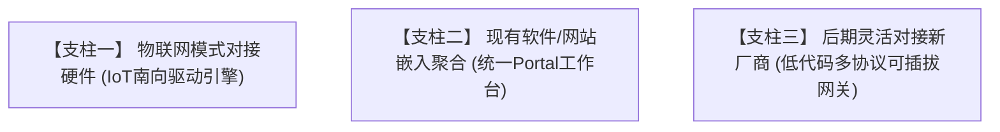
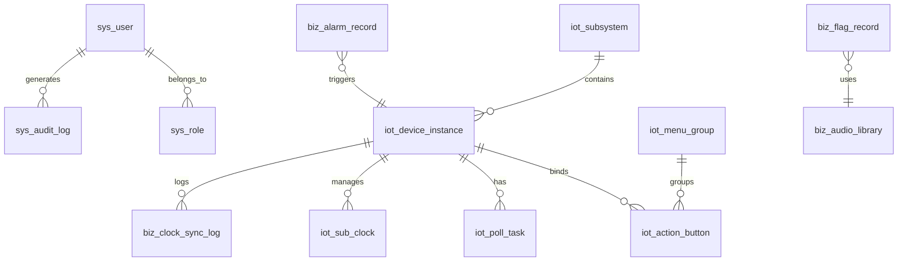

<h1 align="center"><strong>体育场馆应用集成管理系统 开发功能清单和整体规划</strong></h1>

> **依据标准**：以合同《附件1：应用集成管理系统软件总体需求》与《附件2：应用集成管理系统完整功能细化需求清单》为核心依据，严格对标所有业务功能点与非功能性要求。

---

## 一、 项目概述与总体目标

### 1.1 项目背景
本项目为面向现代化体育场馆（特别是含专业游泳跳水等水上运动场馆）的**异构弱电与智能化系统统一集成管控平台（IBMS/集中控制台）**。场馆内部署有来自不同厂商的扩声、场地照明、LED大屏、计时计分、售验票、标准时钟、现场影像采集回放、信息发布、电视转播、自动升旗、水下影像采集识别、音频播放、视频播放等异构软硬件系统，接口协议标准不一（涉及串口、TCP/UDP、Modbus、HTTP、RTSP、HDMI/DP/SDI等）。

### 1.2 核心本质与系统三大支柱（指导方针）
整个系统在产品与架构层面上，本质由**三大核心支柱**构成：



1. **【支柱一】物联网（IoT）模式对接厂商硬件（IoT 南向驱动引擎）**：
   - **以附件1、附件2为基线，完整覆盖13类核心子系统**：明确对标并落地本规划 **“3.3 第三方子系统对接业务功能落地（13类基线子系统）”**，将场馆内基线异构软硬件系统统一纳入管控版图，涵盖：
     1. **扩声系统**（数字调音台推子控制、音源矩阵切换、场景音效调用与设备状态回读）；
     2. **场地照明及控制系统**（赛事/训练/演播/保洁场景照明控制、实时能耗监测与电表采集）；
     3. **LED大屏系统**（Web API/串口双通道控制、信号源无缝切换与画面监视预览）；
     4. **计时计分及现场成绩处理系统**（Socket/HTTP实时成绩捕获与大屏自动联动推送）；
     5. **售验票系统**（门禁闸机核验、票务状态API互通与客流统计）；
     6. **标准时钟系统**（GPS/北斗双模卫星授时母钟、全场单/双面子钟分类拓扑与时钟毫秒级漂移校验）；
     7. **现场影像采集回放系统**（多路RTSP实时预览、设备控制、录像回放与画面抓拍）；
     8. **信息发布服务系统**（多媒体终端推屏、赛程播报排期下发与播放状态监控）；
     9. **电视转播系统**（HDMI/DP/SDI视频采集、编解码与实时画面监测）；
     10. **自动升旗控制系统**（PLC/串口/Web控制、国歌时长与上升距离音画同步测速、仿真模拟动画）；
     11. **水下影像采集识别系统**（水下摄像机控制、识别结果与视频流预览）；
     12. **音频播放服务系统**（音频资源库管理与多通道播放控制）；
     13. **视频播放服务系统**（视频资源库管理与多通道播放控制）。
   - **扩展系统预留**：BAS建筑设备监控、智慧安防、有线电视及前端系统等属于后续可扩展对接范围，不替代上述13类附件基线子系统；如纳入本项目验收范围，应另行确认功能清单、接口边界和交付标准。
   - **统一标准物模型抽象（Digital Twin & Device Profile）**：将上述异构硬件彻底抽象为物联网终端模型，统一归一化为**属性（Property）**、**遥测（Telemetry）**、**服务指令（Command）**与**事件告警（Event）**四大维度。
   - **全生命周期保活与高可靠管控**：依托底层工业串口、Modbus、TCP/UDP、HTTP 等驱动池，建立主动心跳探测（Heartbeat Ping-Pong）、定时遥测轮询、反向控制指令队列、重试超时补偿与异常弹窗/邮件/微信即时告警闭环，构筑高鲁棒性硬件基座。

2. **【支柱二】现有软件/网站嵌入聚合（统一 Portal 工作台）**：
   - **消除“信息孤岛”与操作碎片化**：解决场馆各独立系统分散运行、操作人员须在多台专用工控机或多个独立浏览器间来回切换的长期痛点，打造集大成的**企业级集中管控工作台与统一导航门户**。
   - **兼容 C/S 架构与 B/S 架构混合体**：
     * 充分考虑场馆现场历史软件与专业系统技术路线的多样性，系统必须兼容 **C/S（Client/Server 客户端程序，如基于 C++/C#/Win32 的独立桌面客户端、专业控制台 .exe 程序等）** 与 **B/S（Browser/Server 网页端，如 Web 后台管理系统、SaaS 页面、H5 监控看板等）** 的复杂混合共存环境；
     * **B/S 架构聚合方案**：深度集成 SSO/SLO 单点登录/单点登出鉴权机制，利用内置安全隔离与代理容器（iframe Proxy / 微前端沙箱），实现跨域免密直达、菜单级嵌入集成与生命周期管理；
     * **C/S 架构聚合方案**：支持通过“自定义注册表 URL 协议唤醒（Custom URI Scheme）”、本地轻量代理服务或系统调用，实现从统一 Web 门户一键唤醒并调度本地 C/S 桌面客户端，支持启动时安全透传参数（如当前操作员凭证、比赛场次编号、项目配置路径），并对本地关键进程运行状态实施探测保活。
   - **关键前置决策：明确部署架构形态（本地私有化部署 vs 云端部署）**：
     * **本地私有化部署（On-Premise / 场馆机房局域网部署）**：服务器部署于场馆边缘物理机房，优势在于处于同一局域网（LAN），可原生直连本地硬件（串口服务器、本地 PLC、私网 TCP/UDP 设备）并无缝与现场操作员的 C/S 客户端交互，安全性高、网络时延极低且无外网依赖；但需配备现场服务器硬件与专人运维保障；
     * **云端部署（Cloud / 混合云托管部署）**：服务部署于公有云或政企专有云，优势在于具备弹性算力、异地容灾、多场馆集约化管理与外网移动端便捷访问；**但在云端架构下，云服务器无法直接穿透访问场馆私网内的硬件与 C/S 软件，必须在场馆现场部署“边缘物联网前置网关（Edge Gateway / 前置机）”**，通过加密反向代理/安全双向通道（MQTT/WebSocket/VPN）与云端通信，以实现云端对内网硬件的穿透控制；
     * **落地要求**：在项目实施初期需协同业主及弱电集成商，**正式确认最终部署形态（纯本地部署、纯云端部署或云边协同混合部署）**，以便精准锁定网络拓扑、前置网关硬件选型与安全等级策略。

3. **【支柱三】后期灵活对接新厂商（低代码多协议可插拔网关）**：
   - **对接厂商尽可能灵活【核心战略需求】**：
     * 体育场馆硬件系统更迭频繁、未来可能引入新品牌或更换维保厂商。系统必须具备极限扩展能力，**坚决杜绝针对具体厂商硬编码指令逻辑**，全面采用“协议抽象解耦 + 低代码配置驱动”架构，确保任何新品牌、新协议设备现场**“免改代码、可插拔、即配即用”**。
   - **内置标准化通用默认指令集**：
     * 为提升现场部署效率并规范设备控制流，系统后台为各类设备预置开箱即用的**标准化默认指令模板**，工程人员无需从零手写，只需按需选用或微调：
       1. **开机/通电指令（Power ON）**：明确规范指令名称与动作行为定义（如上电吸合、初始化自检、网络握手上线等）；
       2. **关机/断电指令（Power OFF）**：规范安全休眠、下电断路或待机动作；
       3. **复位/初始化指令（Reset / Init）**：恢复默认预设、矩阵通道归零、状态重置；
       4. **心跳/查询指令（Ping / Query）**：周期性查询硬件健康度与在线状态；
       5. **急停/静音/全关等安全保护指令**。
   - **高度自定义的具体指令填写能力**：
     * 开放底层报文自由定义通道，支持工程人员根据厂商技术文档自由填写与录入具体指令：
       - 支持 **HEX（十六进制报文，如 `55 AA 01 03 ... CRC`）** 与 **ASCII 字符指令（如 `POWR 1\r\n`）** 自由切换；
       - 支持 HTTP RESTful 接口的动态请求头（Header）、请求体（JSON/Form）、路径参数；
       - 支持动态参数宏占位符（如 `{volume}`、`{channel}`、`{checksum}` 等在运行时自动计算注入）；
       - 支持图形化配置设备回传报文的校验机制（CRC16/LRC/和校验）与提取规则（正则切片、JSONPath），解析后实时更新界面组件。
   - **多元化执行时间与调度模式（灵活时序控制）**：
     * **立即执行（Immediate）**：指令点击即发，低至毫秒级下发，满足比赛高实时性操控；
     * **延时执行（Delay X ms/s）**：可自由配置延时时长（如“延时 500ms”、“延时 3s”），满足大功率设备梯次延时上电防浪涌冲击、矩阵切换缓冲等场景；
     * **定时执行（Scheduled / Cron）**：支持指定绝对时间点（如开赛前 15 分钟）或 Cron 周期计划（如每日 08:00 自动开启场馆照明与空调，22:00 自动执行关机休眠）；
     * **宏任务/时序场景联动链（Macro Chain）**：支持将多个设备、多条不同执行时序的指令自由编排组合为“一键场景宏”（如：执行“颁奖场景” -> 立即切换颁奖灯光 -> 延时 1 秒切换扩声颁奖进行曲 -> 延时 2 秒升旗系统启动上升并联动大屏推屏），极大降低现场复杂多设备联调操控门槛。
   - **配置资产化与全流程复用**：系统支持将所有子系统定义、协议参数、菜单结构、操作按钮、指令集一键导出为标准 JSON 模板文件；在后续扩建、新场馆交付或设备迁移时一键导入恢复，大幅压降交付与二次开发成本。

---

### 1.3 核心目标与建设原则
1. **统一管控门户与单点登录**：提供 SSO/SLO 单点登录与登出，一键鉴权打通各子系统入口，实现 PC 端及移动端（平板 H5 横屏）对全场馆设备的一体化监测与控制。
2. **全可视化“低代码”配置驱动（核心壁垒，严格响应附件1-二.3与二.4）**：
   - 彻底摆脱传统写死硬件代码的硬编码模式；
   - 硬件通信协议参数、菜单分组、控制按钮、报文格式（HEX/ASCII）、超时重试、回传解析规则均在页面可视化配置；
   - **接口数量绝不仅限于目前梳理的13个接口，系统支持任意扩展，且接口名称、按钮样式、指令模板均支持完全自定义**；
   - 支持整套配置模板一键导出/导入（JSON），实现多场馆部署秒级复用；
   - 内置“模拟调试模式（Mock）”，未接真实硬件即可完成指令与前端链路验证。
3. **专业业务深度适配**：
   - 自动升旗“音画同步”智能测速算法与前端 Canvas/CSS 仿真模拟动画；
   - 标准时钟卫星授时（北斗/GPS）、全场子钟分类拓扑监控及平台时间与硬件时钟自动比对校验；
   - 计时计分成绩实时捕获与大屏自动推送；
   - 针对无开放 API 的老旧系统，提供**内置浏览器容器（iframe 代理 + SSO 携带参数免密跳转）**降级方案。
4. **多通道告警闭环**：通信链路全天候保活监测，异常时触发**“系统界面弹窗 + 邮件通知 + 微信推送（企微/公众号/消息模板）”**，并自动写入不可篡改的审计日志。

---

## 二、 总体技术架构与方案

系统采用前后端分离 B/S 架构，兼顾高并发工业通信稳定性、低延迟音视频流媒体分发与前端动态 UI 渲染灵活性。

```mermaid
flowchart TB
    subgraph ClientLayer [终端展现层]
        PC[PC端管理运维工作台 (Vue3 + Element-Plus)]
        Tablet[移动平板现场操作台 (Vue3 H5 横屏触控)]
        IframeAgent[内置第三方系统代理容器 (iframe SSO Proxy)]
    end

    subgraph GatewayLayer [网关与接口层]
        APIGateway[FastAPI 异步路由与鉴权网关]
        WS[WebSocket 实时状态与告警推送通道]
    end

    subgraph CoreEngineLayer [核心驱动与业务引擎层]
        DynamicUI[动态元数据与页面渲染引擎]
        ConfigEngine[设备与协议配置中心 (支持任意扩展)]
        FlagEngine[升旗调速算法与音画同步引擎]
        ClockEngine[时钟比对校验与子钟监控引擎]
        AlarmEngine[三级告警引擎 (弹窗 + 邮件 + 微信推送)]
        AsyncTasks[Celery + Redis 异步任务队列]
    end

    subgraph ProtocolDriverLayer [统一全协议通信驱动层 (Abstract Protocol Layer)]
        SerialDriver[串口驱动 (RS232/485 / 网络串口服务器)]
        SocketDriver[TCP/UDP 长连接与心跳断线重连驱动]
        HttpDriver[HTTP/HTTPS RESTful 客户端驱动]
        ModbusDriver[Modbus RTU/TCP 工业总线驱动]
        RTSPDriver[RTSP / WebRTC 低延迟视频流媒体分发]
        HDMIDriver[HDMI/DP/SDI 硬件编解码采集卡桥接]
        LocalScript[本地脚本/可执行程序桥接]
    end

    subgraph StorageLayer [数据持久层]
        MySQL[(MySQL 8.0: 配置元数据 / 权限 / 资源 / 审计日志)]
        Redis[(Redis: 状态缓存 / 指令队列 / 鉴权Session)]
    end

    ClientLayer --> GatewayLayer
    GatewayLayer --> CoreEngineLayer
    CoreEngineLayer --> ProtocolDriverLayer
    CoreEngineLayer --> StorageLayer
```

### 2.1 技术栈清单
* **后端框架**：Python 3.10+ / FastAPI（原生异步高并发、自带 OpenAPI 交互文档）
* **ORM 与数据库**：SQLAlchemy 2.0（异步 AsyncSession） + MySQL 8.0
* **缓存与任务队列**：Redis 7.0 + Celery（用于高频设备轮询、心跳巡检、定时任务、告警队列）
* **底层通信驱动库**：
  * 串口：`pyserial-asyncio`（支持本地物理 COM 口及网络串口服务器 TCP-to-Serial 虚拟端口）
  * 网络与长连接：`asyncio` 原生异步 Socket（TCP/UDP 流处理，具备指数退避自动重连）
  * HTTP 客户端：`httpx` 异步客户端（连接池复用、SSL 支持、动态 Header/Token 注入）
  * 工业总线：`pymodbus`（Modbus RTU 与 Modbus TCP）
  * 音视频多媒体：`FFmpeg` / `mutagen`（毫秒级音频时长与音画解析）
  * 告警推送：`aiosmtplib`（邮件发送）、企业微信应用消息/微信公众号模板消息 SDK（微信推送）
* **前端框架**：Vue 3 + Vite + Pinia + Vue-Router + Element-Plus
* **双端适配**：
  * PC 端：全屏监控、配置中心、全功能操作面板；
  * 平板端：专属 H5 横屏设计、大触控靶心、**核心配置严格隔离**。
* **部署方式**：Docker 容器化部署，跨平台适配 Windows Server / Linux。

---

## 三、 系统完整功能需求逐项对标与落地实施

本章节严格对标《附件2》第一部分6大功能模块及《附件1》全量基线要求，完整覆盖基线功能，并对部分技术实现进行细化；附件未明确要求的扩展能力另行标注，不作为附件基线功能的替代。

### 3.1 统一身份认证与权限管理模块
| 序号 | 需求点 (对标附件2) | 落地设计与实现细节 |
| :---: | :--- | :--- |
| **1.1** | **SSO单点登录** | 平台统一账号登录，一键签发 JWT Token，打通对接系统的集中入口，支持免密单点跳转鉴权。 |
| **1.2** | **SLO单点登出** | 平台退出登录时，通过广播回调通知或 Redis 联合 Session 注销机制，同步使所有子系统会话失效，保障账号安全。 |
| **1.3** | **账号角色管理** | 系统**预设 4 类角色**：**管理员、运维人员、场馆操作员、只读查看者**；并支持在后台自定义新增、编辑、删除角色及分配角色权限。 |
| **1.4** | **细粒度权限控制** | 实现**按钮级与菜单级**权限隔离。普通操作员仅具有设备按钮控制权限；**严禁普通操作员访问/修改通信协议、波特率、IP端口、硬件指令等核心配置**。 |
| **1.5** | **操作审计日志** | 全程记录：用户登录登出、硬件指令下发报文、HTTP接口调用、系统配置修改、设备通信异常。<br>**功能支持**：按时间范围、操作人员账号、设备类型进行多维组合检索；**支持操作审计日志一键导出留存（Excel/CSV）**。 |

---

### 3.2 异构设备与系统配置中心（核心模块，配置驱动引擎）
| 序号 | 需求点 (对标附件2) | 落地设计与实现细节 |
| :---: | :--- | :--- |
| **2.1** | **全协议通信支持** | 兼容串口 RS232/485、HTTP/HTTPS、TCP、UDP、Socket、Modbus RTU/TCP、RTSP 流，以及调用本地 exe 程序和脚本文件（.bat/.sh/.py）。 |
| **2.2** | **串口协议自定义配置** | 支持本地串口（COM口）及网络串口服务器（IP+Port）；可视化配置**波特率（1200~115200）、校验位（None/Odd/Even）、数据位（5~8）、停止位（1/1.5/2）**；兼容 **ASCII 与 HEX 十六进制**双格式指令；支持自定义通信超时（ms）、重试次数、回传报文解析规则（正则/切片截取）。 |
| **2.3** | **HTTP接口自定义配置** | 自定义目标 URL、请求方法（GET/POST/PUT/DELETE）、请求 Header、请求 Body（JSON/表单）、Token/Bearer 鉴权参数，适配所有 RESTful 第三方 API。 |
| **2.4** | **TCP/UDP通信配置** | 支持设备 IP、端口号配置；支持配置心跳包报文、心跳周期；支持断线自动重连策略（重连间隔与最大次数）。 |
| **2.5** | **子系统实例管理** | 支持任意新增、编辑、删除硬件/软件实例；自定义设备厂商、设备名称、功能备注，分类标签管理。**接口数量不限，名称完全自定义**。 |
| **2.6** | **自定义菜单分组** | 支持功能菜单分组的新增、编辑、删除与拖拽排序（如扩声控制、灯光控制、升旗系统、大屏控制等）。 |
| **2.7** | **自定义操作按钮** | 自定义按钮显示名称与样式；按钮可绑定串口指令、TCP报文或 HTTP 请求；可配置指令发送延时、等待响应时间、回传数据校验规则。 |
| **2.8** | **设备状态轮询配置** | 可自定义状态轮询指令、轮询周期（秒），自动解析设备回传报文，前端通过红绿灰三色实时展示设备**“在线、离线、故障”**状态。 |
| **2.9** | **配置导入导出** | 支持整套系统配置（子系统、设备、菜单、按钮指令）一键导出为标准 JSON 模板文件；新场馆可一键导入恢复，实现快速复用部署。 |
| **2.10**| **外置硬件适配登记** | 后台提供专门登记页面，记录外置转换器/适配器（如 USB转RS485、网络串口服务器、光电隔离器）的**型号、接线方式、接线引脚定义与适配维护说明**。 |
| **2.11**| **模拟调试模式** | 后台提供全局或单设备“模拟调试模式（Mock）”开关。开启后指令仅在虚拟沙箱中收发回显，不向下位机真实硬件下发，方便现场未接线时调试界面与逻辑。 |

---

### 3.3 第三方子系统对接业务功能落地（13大子系统）

#### 3.3.1 扩声系统接口（串口对接）
- **音源切换控制**：通过配置化按钮下发调音台控制代码，实现输入/输出通道任意矩阵切换。
- **场景音效输出**：一键调用赛事、开场、颁奖、闭幕等预设混合音效场景。
- **设备状态回读**：定时轮询读取电子调音台通道推子音量、工作状态与在线状态并在界面展示。

#### 3.3.2 场地照明及控制系统接口（串口/Modbus对接）
- **灯光场景控制**：一键切换赛事级照明、训练模式、演播模式、日常保洁等预设组合灯光。
- **能耗监测统计**：定时轮询智能照明控制器/电表数据，前端实时展示实时能耗功率（kW）与累计电量（kWh），生成能耗折线图。
- **设备状态监控**：实时监控照明控制器通信在线、离线、故障状态，异常即时弹窗告警。

#### 3.3.3 LED大屏系统接口（Web API / 串口双通道）
- **大屏信号源切换**：一键切换大屏输入源（现场摄像机、赛事成绩、宣传视频、外部 HDMI 输入）。
- **大屏状态监测**：监测大屏控制器工作状态、输出分辨率及画面状态，前端提供小窗视频/截图预览，实时监视大屏输出画面。

#### 3.3.4 计时计分及现场成绩处理系统接口
- **比赛成绩实时获取**：通过 TCP Socket/HTTP 实时接收计时计分主控机上屏软件输出的比赛成绩（排名、用时、犯规状态等）。
- **成绩大屏推送**：接收成绩数据后，联动调用 LED 大屏推屏接口，实现比赛成绩全自动/一键上屏展示。

#### 3.3.5 售验票系统接口（HTTP Web 对接）
- **票务接口调用**：调用售验票系统开放 API，执行售票出票、验票核验、余票查询、客流订单统计操作。
- **无接口降级方案**：针对无开放 API 的老系统，提供**内置 iframe 代理容器**内嵌系统后台，SSO 自动携带 Token/参数免密跳转。

#### 3.3.6 标准时钟系统接口（TCP/UDP 对接）
- **时钟信息采集**：通过 TCP/UDP 实时读取硬件服务器运行连接的**卫星颗数（GPS/北斗）**、时区信息、标准北京时间。
- **子钟状态总览**：全场子钟**总数、故障数量、分类数量（单面钟/双面钟/数码钟）**统计总览，列表直观展示每台子钟运行、故障、离线状态。
- **系统时间校验**：定时自动比对管控平台本地服务器时间与标准母钟系统时间，计算时钟漂移差值（ms）并告警，保障全场馆时间毫秒级同步。
- **数据持久化与明细建模**：定时轮询自动更新 `iot_sub_clock`（记录每台子钟分类、所在看台/比赛大厅等位置、运行状态与故障原因），并将卫星授时对时数据沉淀至 `biz_clock_sync_log`，供前端总览看板直接做分类聚合展示与历史漂移分析。

#### 3.3.7 现场影像采集回放系统接口（RTSP + Web 对接）
- **多路RTSP拉流预览**：前端支持 4/9 分屏多路 RTSP 实时视频拉流预览（通过后端 WebRTC/HTTP-FLV 流媒体网关分发，延迟 < 300ms）。
- **设备控制、录像回放与画面抓拍**：通过 Web 接口实现云台 PTZ 控制、历史录像按时段检索回放、关键帧画面抓拍下载；无接口时通过 iframe 降级嵌入。

#### 3.3.8 信息发布服务系统接口（HTTP Web 对接）
- **信息发布管理**：通过 API 调用实现场馆大厅图文公告、引导屏内容的新增、发布、排期、编辑、删除全流程管理。
- **接口降级访问**：未开放 API 时，通过内置 iframe 免密单点跳转直接操作信息发布后台。

#### 3.3.9 电视转播系统接口（HDMI/DP/SDI 编解码硬件采集）
- **硬件桥接与视频预览**：场馆转播摄像机的 HDMI/SDI 信号接入专业音视频采集/解码板卡，通过板卡 SDK 采集视频信号并编码为内网流媒体（RTSP/WebRTC），平台端实现转播画面实时监视与预览，达到监看电视台转播画面的要求。

#### 3.3.10 自动升旗系统接口（Web/串口双通道，重点业务）
- **音频文件管理**：国歌、颁奖曲、迎宾曲等音频文件的上传、增删改查、分类管理与试听。
- **智能调速算法（音画同步）**：
  - 音频上传后，后台利用 `mutagen`/`FFmpeg` 精确解析音频净播放时长 $T$（秒）；
  - 结合旗杆物理有效行程高度 $H$（米）与加减速缓冲时间 $t_b$ 计算电机运行速度与脉冲频率：
    $$V_{target} = \frac{H}{T - t_b}$$
  - 支持普通升旗、降旗、颁奖升旗联动，确保“歌毕旗至顶”。支持最高优先级**紧急停止**控制。
- **升旗模拟动画**：前端提供基于 Canvas/CSS 的高仿真升旗虚拟运行演示界面，方便脱机调试、仪式彩排和动作预览。

#### 3.3.11 水下影像采集识别系统接口（RTSP + Web 对接）
- **设备远程控制**：通过 Web 接口远程调节水下摄像机拍摄角度、曝光参数、识别模式。
- **识别结果与画面预览**：前端多窗口预览水下画面，实时可视化呈现游泳运动员触壁识别、姿态分析与安全防溺水告警标记。

#### 3.3.12 音频播放服务接口
- **音频资源库管理**：场馆背景音乐、提示音素材库的上传、分类、编辑、检索与删除。
- **音频播放控制**：任意选择音频通道输出、播放、暂停、停止、音量线性调节。

#### 3.3.13 视频播放服务接口
- **视频资源库管理**：场馆宣传片、赛事回放精彩剪辑等视频文件支持上传、新增、编辑、删除、分类管理、码率/时长查看与条件检索。
- **视频播放控制**：自定义选择视频输出通道，支持播放、暂停、停止、切换视频、切片轮播与投屏大屏。

---

### 3.4 内置浏览器容器（iframe 代理模块）
- **一站式内嵌访问**：在平台统一框架内，无需跳转外部浏览器，直接内嵌打开老旧第三方系统管理后台。
- **单点登录免密携带**：支持在 iframe 请求头或 URL query 参数中自动附带签名 Token 或 Ticket，实现免密静默登录。
- **交付边界说明**：当前方案为标准 B/S 网页架构，采用后端代理与 iframe 实现第三方系统内嵌访问；桌面端原生 WebView 客户端不属于当前标准交付范围，如有需要须另行确认并进行定制开发。

---

### 3.5 移动端平板 H5 专属适配
- **平板横屏专属设计**：基于 Vue3 针对平板视口（如 10.1~12.9 寸，1920×1200 / 2560×1600）做横屏触控交互定制，按钮尺寸优化为 48px+，适合现场触控。
- **现场操作台模式**：支持设备按钮一键触发、升旗控制、多路视频监看、音响灯光模式切换。
- **严格权限物理隔离（防呆机制）**：**平板端彻底剔除并隐藏通信协议配置、波特率修改、指令报文编辑等敏感功能**，仅保留操作按钮面板，彻底防止现场误操作导致的设备失联。

---

### 3.6 告警与系统监控模块
- **全链路心跳监控**：实时监控所有串口（COM口存活）、网络长连接（TCP/UDP 心跳）、HTTP 探测（HTTP 200 OK）与 RTSP 流通畅状态。
- **三级立体告警机制（严格响应附件2 6.2）**：
  1. **第一级（界面实时）**：Web 界面全局弹窗强提醒 + 声音警报 + 状态灯变红；
  2. **第二级（邮件推送）**：调用 SMTP 异步发送告警邮件至运维管理人员邮箱；
  3. **第三级（微信推送）**：对接企业微信机器人 Webhook 或 微信公众号模板消息 / 微信小程序通知，实时将故障设备、错误报文推送至运维人员手机端。
- **自动归档**：告警全量写入操作审计日志库，便于事后复盘追溯。

---

## 四、 完整数据库模型设计规划 (Schema Draft)

为承载强大的配置化能力与 13 大子系统业务，数据库表设计规划如下（统一收敛于 `install.sql`）：



1. **用户、权限与审计域**：
   - `sys_user`：用户表（用户ID、账号、密码哈希、姓名、角色ID、状态）
   - `sys_role`：角色表（角色ID、角色编码[admin/ops/operator/viewer]、角色名称、权限JSON）
   - `sys_audit_log`：审计日志表（日志ID、用户ID、模块名、设备类型、请求指令报文、回传响应、执行结果、客户端IP、耗时ms、创建时间）
2. **设备与配置驱动域（核心元数据引擎）**：
   - `iot_subsystem`：子系统定义表（ID、系统编码、系统名称、系统分类、通信协议类型[SERIAL/TCP/UDP/HTTP/MODBUS/RTSP]、厂商信息）
   - `iot_device_instance`：设备实例表（ID、子系统ID、实例名称、连接配置JSON[波特率/IP/端口/校验位/停止位等]、在线状态、心跳周期）
   - `iot_menu_group`：菜单面板分组表（ID、分组名、显示图标、排序权重、终端范围[PC/Tablet/ALL]）
   - `iot_action_button`：自定义操作按钮表（ID、分组ID、设备ID、按钮文本、按钮样式/颜色、指令编码[HEX/ASCII/JSON]、指令模板、等待延时ms、回传解析规则[正则/JSONPath]、防抖秒数）
   - `iot_poll_task`：状态轮询规则表（ID、设备ID、轮询指令、轮询周期秒数、状态映射字典JSON）
   - `iot_hardware_adapter`：外置硬件适配登记表（ID、适配器型号、通信转换方式、接线引脚定义、拓扑图路径、维护说明）
   - `iot_sub_clock`：**子钟设备明细与分类状态表**（ID、母钟设备ID `device_id`、子钟编号 `clock_code`、子钟类型 `clock_type`[单面钟/双面钟/数码钟/指针钟]、物理安装位置 `location`[如看台区/比赛大厅/热身馆/裁判席]、通信运行状态 `status`[在线/故障/离线]、故障原因说明 `fault_reason`、最后心跳上报时间 `last_heartbeat`）
3. **专业业务与媒体域**：
   - `biz_audio_library`：音频文件表（ID、音频名称、存储路径、文件Hash、时长毫秒、采样率、音频分类[国歌/颁奖/背景音]）
   - `biz_video_library`：视频文件表（ID、视频名称、存储路径、分辨率、时长秒、文件大小、视频分类）
   - `biz_flag_record`：升旗执行日志表（ID、旗杆号、绑定音频ID、设定速度m/s、开始时间、结束时间、是否急停、执行状态）
   - `biz_alarm_record`：告警事件表（ID、设备ID、告警级别[一般/警告/紧急]、告警信息、微信推送状态、邮件发送状态、恢复时间）
   - `biz_clock_sync_log`：**标准时钟授时比对与同步日志表**（ID、母钟设备ID `device_id`、连接卫星颗数 `satellite_count`[北斗/GPS颗数]、时区信息 `time_zone`[如 UTC+8]、母钟硬件标准时间 `master_time`、管控平台本地服务器时间 `local_time`、时钟漂移毫秒数 `drift_ms`、校验结果状态 `sync_status`[正常/偏差告警]、记录创建时间 `created_at`）

---

## 五、 项目开发里程碑、合同付款节点与实施进度计划表

为保障商务履约与工程技术落地的强协同，本项目建立**“商务付款里程碑”与“技术研发实施进度”双线闭环管控机制**。
技术研发总周期严格按照 **80 个自然日**（**2026年10月10日 ~ 2026年12月28日**）推进，前 65 天完成设计、全端研发与容器化封版，**预留最后 15 天（2026年12月14日 ~ 2026年12月28日）作为全场馆封闭内测与试运行阶段**；系统正式上线后进入**连续稳定运行满 1 个月**的保障期，完成终验。

---

### 5.1 合同阶段与实施推进里程碑总览表 (阶段流转与准入条件)

| 合同推进阶段 | 阶段周期 (年月日) | 对应技术实施节点 | 交付成果与验收要求 | 阶段流转与下一阶段准入条件 |
| :---: | :---: | :--- | :--- | :---: |
| **第一阶段：<br>合同签约** | **合同签署日**<br>*(已完成)* | 项目正式立项启动与商务协议签署 | 明确系统建设边界与需求输入，确定双方项目组架构及工作机制。 | **合同签约生效，已进入下一阶段** |
| **第二阶段：<br>原型/设计确认**<br>*(对应条款②)* | **2026-10-10<br>~ 2026-10-18**<br>*(共 9 天)* | **阶段一：原型、需求设计与界面设计**<br>1. 制定规划《开发功能清单和整体规划》<br>2. 制定规划《菜单设计和页面规划及数据库规范》<br>3. 制定规划《UI界面设计规范和效果图》 | 乙方完成上述三项核心规划设计并组织专题汇报。 | **甲方审阅核对确认后，进入下一阶段**<br>*(甲方在《设计确认单》上签字确认)* |
| **第三阶段：<br>前后端开发初验**<br>*(对应条款③)* | **2026-10-19<br>~ 2026-12-13**<br>*(共 56 天)* | **阶段二 ~ 阶段五：前后端全栈研发与联调**<br>• 异步底座、全协议驱动网关与配置中心<br>• 13大异构子系统业务落地与算法验证<br>• 移动平板专属横屏操作台与敏感参数防呆<br>• 第三方老系统安全 iframe 代理与三级告警<br>• Docker 容器化打包构建与准生产环境部署 | 乙方完成全部前后端开发工作与脱机演练，提交初验测试用例与报告，进行功能走查初验。 | **甲方审阅核对初步验收合格后，进入下一阶段**<br>*(签署《初步验收确认文件》)* |
| **第四阶段：<br>集成上线与终验**<br>*(对应条款④)* | **2026-12-14<br>~ 2027-01-28**<br>*(内测15天 +<br>试运行31天)* | **阶段六：全场馆封闭内测与连续稳定运行**<br>• 2026-12-14 ~ 2026-12-28 (15天)：全场馆封闭内测、72h压测与操作员签收<br>• **2026-12-28 正式集成上线并投入运行**<br>• 2026-12-29 ~ 2027-01-28 (满1个月)：连续稳定试运行保障、日常巡检与缺陷清零 | 乙方完成项目集成上线并投入运行，系统在现场连续稳定运行满 1 个月，无重大故障。 | **甲方审阅核对无误后，签署终验文件正式结项**<br>*(签署《最终验收报告》)* |

---

### 5.2 技术研发实施任务全景分解表 (80 个自然日 + 1 个月稳定试运行)

| 任务阶段 | 任务编号 | 关键开发任务与实施内容 | 具体执行日期 (年月日) | 工期 | 对应交付产物与流转节点 |
| :--- | :---: | :--- | :---: | :---: | :--- |
| **【阶段一】<br>原型需求与界面设计**<br>*(2026-10-10 ~ 2026-10-18)*<br>*(共 9 天 / 对标条款②)* | T1.1 | 制定规划《开发功能清单和整体规划》与数据库全量建模 | 2026-10-10 ~ 2026-10-13 | 4 天 | 《开发功能清单和整体规划》、建表脚本 `install.sql` |
| | T1.2 | 制定规划《菜单设计和页面规划及数据库规范》 (24个页面全景) | 2026-10-12 ~ 2026-10-15 | 4 天 | 《菜单设计和页面规划及数据库规范》、SVG 图标规范 |
| | T1.3 | 制定规划《UI界面设计规范和效果图》 (深色UI规范与全套效果图) | 2026-10-14 ~ 2026-10-17 | 4 天 | 《UI界面设计规范和效果图》、高保真设计图全套 |
| | T1.4 | 原型与三项规划成果甲方专题汇报、确认与会签 | 2026-10-17 ~ 2026-10-18 | 2 天 | **甲方审阅核对后签署《设计确认单》，进入下一阶段** |
| **【阶段二】<br>配置驱动与通信引擎**<br>*(2026-10-19 ~ 2026-11-02)*<br>*(共 15 天)* | T2.1 | FastAPI 异步架构与全协议驱动网关 (串口/TCP/Modbus/HTTP) | 2026-10-19 ~ 2026-10-25 | 7 天 | 工业通信调度抽象层、长连接池 |
| | T2.2 | 设备配置中心与控制按钮/HEX指令可视化绑定后台 | 2026-10-23 ~ 2026-10-28 | 6 天 | 低代码设备建模与指令规则解析模块 |
| | T2.3 | 前端元数据动态解析与万能操作面板渲染引擎 | 2026-10-25 ~ 2026-11-01 | 8 天 | 配置驱动万能界面组件、按键状态机 |
| | T2.4 | 通信模拟调试沙箱 (Mock 模式) 与 JSON 配置导入导出 | 2026-10-29 ~ 2026-11-01 | 4 天 | 脱机调试沙箱、场馆模板备份还原包 |
| | T2.5 | 外置硬件适配登记台账与接线拓扑维护模块 | 2026-11-01 ~ 2026-11-02 | 2 天 | 转换器与串口服务器引脚台账功能 |
| **【阶段三】<br>13大子系统业务落地**<br>*(2026-11-03 ~ 2026-11-23)*<br>*(共 21 天)* | T3.1 | 音频/视频媒体素材库开发与独立播控服务对接 | 2026-11-03 ~ 2026-11-07 | 5 天 | 毫秒时长精准解析、背景乐与投屏控制台 |
| | T3.2 | 自动升旗智能调速算法、仿真动画与急停安全保护 | 2026-11-08 ~ 2026-11-13 | 6 天 | 音画同步测速算法、Canvas 升旗仿真台 |
| | T3.3 | 扩声调音串口矩阵、照明场景控制与能耗监测驱动 | 2026-11-05 ~ 2026-11-11 | 7 天 | 调音推子联动、灯光情景与能耗趋势图 |
| | T3.4 | 标准时钟卫星授时采集、本地时间比对与子钟拓扑 | 2026-11-12 ~ 2026-11-15 | 4 天 | 北斗/GPS 授时校准、子钟分类监测看板 |
| | T3.5 | 现场及水下多路 RTSP 低延迟监看与 AI 识别结果呈现 | 2026-11-14 ~ 2026-11-19 | 6 天 | 4/9/16 分屏流媒体矩阵、断流自愈播放器 |
| | T3.6 | HDMI 视频采集网关与计时计分实时推屏联动 | 2026-11-17 ~ 2026-11-21 | 5 天 | 转播画面预览、成绩大屏一键/自动推屏 |
| | T3.7 | 售验票数据统计与信息发布全流程发布管理 | 2026-11-20 ~ 2026-11-23 | 4 天 | 票务数据看板、大屏图文排期发布组件 |
| **【阶段四】<br>双端协同与运维安全**<br>*(2026-11-24 ~ 2026-12-03)*<br>*(共 10 天)* | T4.1 | 移动平板 H5 横屏专属工作台与权限物理隔离 | 2026-11-24 ~ 2026-11-29 | 6 天 | 平板 48px+ 大触控面板（敏感配置严格隐藏） |
| | T4.2 | 内置安全 iframe 反向代理容器与老系统免密跳转 | 2026-11-26 ~ 2026-11-29 | 4 天 | 第三方系统免密单点嵌入、防眩光滤镜 |
| | T4.3 | 全链路心跳保活与三级告警 (界面弹窗/邮件/微信推送) | 2026-11-29 ~ 2026-12-03 | 5 天 | 企微 Webhook、微信模板消息与邮件闭环 |
| | T4.4 | 操作审计日志多维检索与 Excel/CSV 一键导出 | 2026-12-01 ~ 2026-12-03 | 3 天 | 审计流水大表、安全回溯与报表导出 |
| **【阶段五】<br>集成演练与初验封版**<br>*(2026-12-04 ~ 2026-12-13)*<br>*(共 10 天 / 对标条款③)* | T5.1 | 13 大异构子系统全业务全链路脱机演练与联调 | 2026-12-04 ~ 2026-12-08 | 5 天 | 全流程业务联动无阻断测试 |
| | T5.2 | Docker 容器化打包、部署脚本与系统封版提测 | 2026-12-08 ~ 2026-12-11 | 4 天 | 生产 Docker 镜像包、系统部署手册 |
| | T5.3 | 系统初步验收评审、功能走查与初验文件会签 | 2026-12-12 ~ 2026-12-13 | 2 天 | **甲方审阅核对后签署《初步验收确认文件》，进入下一阶段** |
| **【阶段六】<br>全场馆封闭内测 (15天)**<br>*(2026-12-14 ~ 2026-12-28)*<br>*(共 15 天内测期)* | T6.1 | 全真赛事业务流程模拟内测与长流程联动演练 | 2026-12-14 ~ 2026-12-19 | 6 天 | 模拟赛事全链路（开门->升旗->比赛推屏->播控） |
| | T6.2 | 工业网络抗干扰容灾、高频并发与 72h 稳定性压测 | 2026-12-20 ~ 2026-12-24 | 5 天 | 72小时长连接保活压测、断流自愈验证 |
| | T6.3 | 场馆操作员实操走查考核、缺陷清零与**系统正式上线投运** | 2026-12-25 ~ 2026-12-28 | 4 天 | **2026-12-28 达到 80 天节点，系统正式上线投运！** |
| **【阶段七】<br>连续稳定运行与终验**<br>*(2026-12-29 ~ 2027-01-28)*<br>*(满1个月 / 对标条款④)* | T7.1 | 系统现场投运技术保障、日志巡检与常态化运行支持 | 2026-12-29 ~ 2027-01-28 | 31 天 | 连续稳定运行 1 个月零重大故障运行记录 |
| | T7.2 | 试运行总结报告编制、最终验收审核与签署终验文件 | 2027-01-26 ~ 2027-01-28 | 3 天 | **甲方审阅核对无误后签署《最终验收报告》，项目终验结项** |

---

### 5.3 验收交付物与文件会签规范

1. **原型与界面设计确认交付物（对应阶段二 / 条款②）**：
   - 制定规划《开发功能清单和整体规划》（即本方案书及实施计划）
   - 制定规划《菜单设计和页面规划及数据库规范》（含 24 页面矩阵与 `install.sql` 结构）
   - 制定规划《UI界面设计规范和效果图》（含深色规范说明书与全套高保真设计图）
   - 签署文件：**《项目原型与UI设计确认书》（甲方审阅核对通过并盖章确认，进入下一阶段）**
2. **前后端开发与初步验收交付物（对应阶段五 / 条款③）**：
   - 《全系统前后端源代码及完整工程包》
   - 《系统部署与容器化运行手册（Docker）》
   - 《系统功能测试报告（含13大子系统联调记录）》
   - 签署文件：**《项目初步验收确认文件》（甲方审阅核对通过并盖章确认，进入下一阶段）**
3. **集成上线与稳定运行满1个月终验交付物（对应阶段七 / 条款④）**：
   - 《系统连续稳定运行满1个月日常巡检与日志报告》
   - 《现场操作员培训记录与签到表》
   - 《用户操作使用手册》与《系统运维应急预案》
   - 签署文件：**《项目最终验收报告》（甲方审阅核对通过并盖章确认，项目终验结项）**

---

## 六、 关键技术难点攻关专项方案

### 6.1 串口与工业网络并发通信稳定性（防粘包、防锁死）
* **方案**：
  - 串口独占特性决定了同一 COM 口不能并发写入。针对每个串口物理实例建立异步互斥锁（`asyncio.Lock`）与指令待发队列；
  - 设定严格的指令响应超时计时器（如 300ms），超时自动重试（可配置重试次数），重试失败优雅抛出告警，绝不阻塞整个 FastAPI 事件循环；
  - 针对长连接 TCP/UDP，采用环形缓冲区（Ring Buffer）配合帧头/帧尾（Delimiter）分包解析，彻底杜绝粘包和半包。

### 6.2 自动升旗系统的“精准音画同步”算法与安全保护
* **算法公式**：
  $$V_{pulse} = \frac{H_{effective} \times K_{motor}}{T_{audio} - T_{buffer}}$$
  - $H_{effective}$：旗杆物理有效升降高度（米）
  - $K_{motor}$：电机每米脉冲当量（Pulse/m）
  - $T_{audio}$：国歌/颁奖曲音频实际有效播放总时长（秒，毫秒级读取）
  - $T_{buffer}$：电机起步加减速与末端到位缓冲时间预留（通常取 1.5~2.0 秒）
* **双重保护机制**：
  - 前端实时 Canvas 动画按相同时间轴模拟旗帜高度上升；
  - 紧急停止（E-STOP）指令设置最高执行队列优先级（VIP Priority），一键秒级切断脉冲输出。

### 6.3 电视转播（HDMI/DP/SDI）信号如何进入 B/S 架构
* **方案**：
  - 纯 B/S 网页无法直接插入物理 HDMI 视频线。方案采用“硬件编解码板卡/HDMI推流编码器 -> 硬件直接转 H.264/H.265 RTSP 码流 -> 流媒体服务器转 WebRTC/HTTP-FLV -> 前端 `<video>` 低延迟渲染”；
  - 满足附件2“通过视频解码板卡SDK实时监测、预览转播视频画面”的规范要求。

### 6.4 微信推送与邮件异步告警队列
* **方案**：
  - 告警发生时，由主线程生成告警事件投递到 Redis 告警队列；
  - 由后台 Celery/异步 Worker 并发消费，执行企业微信 Webhook 签名推送、微信公众号模板消息下发以及 SMTP 邮件派发；
  - 杜绝因外网网络波动导致主控制台卡顿。

### 6.5 视频监控与转播流媒体断流自愈与平滑重连
* **方案**：
  - 场馆现场多路 RTSP/WebRTC 流媒体在局域网交换机抖动、VLAN 切换或摄像机重启时易发生卡死或黑屏；
  - 前端流媒体播放器组件封装断流自愈状态机：监听底层 `onError` 与 `onStalled` 事件，启动指数退避定时器（1s -> 3s -> 5s 自动重拉流），平滑重建 WebRTC PeerConnection 或 HTTP-FLV 管道，杜绝现场监控黑屏与手动刷新页面的繁琐。

---

## 七、 质量与安全交付准则

1. **零硬编码原则**：所有硬件通信指令、界面菜单、按钮动作均经由配置中心加载，严禁在前端或后端代码中写死特定厂商私有报文。
2. **规范化数据库同步**：数据库结构变化必须严格更新 `install.sql`，并提供增量升级迁移脚本。
3. **严格语法与逻辑自检**：每次代码修改后严格执行语法检查与端到端链路自检，保障生产环境交付质量。
